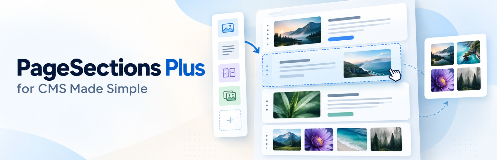

# Page Sections Plus



CMS Made Simple module. Version 1.6.7. It adds a `{content_module}` block for repeatable two-column sections.

## Install

1. Copy this folder to `modules/PageSectionsPlus`.
2. In the admin, open **Extensions → Modules** and install **Page Sections Plus**.
3. Add this tag to a page template:

```smarty
{content_module module="PageSectionsPlus" block="sections" label="Page Sections"}
```

## Upgrade

1. Copy the new files over `modules/PageSectionsPlus`.
2. Open **Extensions → Modules** and click **Upgrade** beside Page Sections Plus.
3. Clear `tmp/cache` and `tmp/templates_c`.

Upgrading from 1.0.0 registers the frontend template in Design Manager. A customised 1.0 module template is copied across when the Design Manager copy is still the factory default.

## Editor

- Drag the handle to reorder sections.
- Each side has its own Bootstrap background.
- **WYSIWYG** uses the CMSMS editor for normal formatted text.
- **Gallery (GMS)** lets editors select a saved gallery without entering a module tag. Pictures and layout are managed in Gallery Made Simple; each gallery uses its saved template.
- **Image** offers **Upload image**, **Use image link +**, and the native CMSMS **File Picker**. Imported URLs are copied onto the hosting, and the preview appears in the box.
- Image position is left, centre, or right.
- Each picture in each section has its own **Tilt picture** checkbox. Untick it for a straight picture. New pictures and existing pictures without a saved choice default to ticked. Explicitly unticked choices remain unticked after saving, reordering or swapping sides.
- Custom frontend templates can use `$col.tilt` (or `$item.left.tilt` / `$item.right.tilt`), which is `'1'` for tilted and `'0'` for straight. The Bootstrap template honours it. Custom templates can use this value to choose their own image styling.

## Permissions

Version 1.5.0 adds separate Backend Group Permissions for deleting sections, reordering and swapping, File Picker, image-link import, content type, and backgrounds. Restricted controls are hidden, but editors can still change text and alt text and upload images using the upload button or pencil icon.

**Page Sections Plus: view help** controls the help text under **Extensions → Modules → Help** and the Page Sections Plus screen under Extensions. Leave it unchecked to hide that help. The Admin group receives it on install and upgrade. After changing the permission, log out and back in.

## External image requests

**Use image link** does not use a fixed third-party service. It sends an HTTP(S) GET request from the hosting server to the exact public image URL entered by the editor, transmitting the normal request headers and server IP address. The selected website supplies its own Terms of Service and Privacy Policy; review those on that website before importing its image. No request is made until an editor chooses to import a URL.

- Purpose: copy the editor-selected public image onto the CMSMS hosting.
- Data sent: a GET request, normal HTTP headers, and the hosting server's IP address.
- Terms of Service URL: no fixed URL; it is the terms URL published by the editor-selected image host.
- Privacy Policy URL: no fixed URL; it is the privacy URL published by the editor-selected image host.

## Frontend

- Both sides filled: two columns.
- Only text on one side: that text spans the full width.
- Only an image on one side: the image sits left, centre, or right.

Two Design Manager templates are installed:

- **PageSectionsPlus Basic** is the default. It contains minimal Smarty output without a frontend data dump or layout framework.
- **PageSectionsPlus Bootstrap** is the complete frontend layout, focused on websites using Bootstrap 5.3.

Select the Bootstrap template with:

```smarty
{content_module module="PageSectionsPlus" block="sections" template="PageSectionsPlus Bootstrap"}
```

Edit either template under **Layout → Design Manager → Templates**.

Help for the module is in `doc/module_help.inc`. It is shown under **Extensions → Modules → Help** only for groups that have **Page Sections Plus: view help**.

## Public distribution (1.6.6)

The module and examples use general-purpose names, with no site content or
images included. Syntax checks passed locally; installation in a running
CMSMS site remains to be verified. The Basic template supplies unstyled content output. Use the Bootstrap
template for a complete layout.

## Forge preparation (1.6.7)

Removed the factory Basic template’s developer inspection output. Upgrades
refresh only the unchanged previous factory Basic template; customised
templates remain intact. Added licence headers and the project banner.
